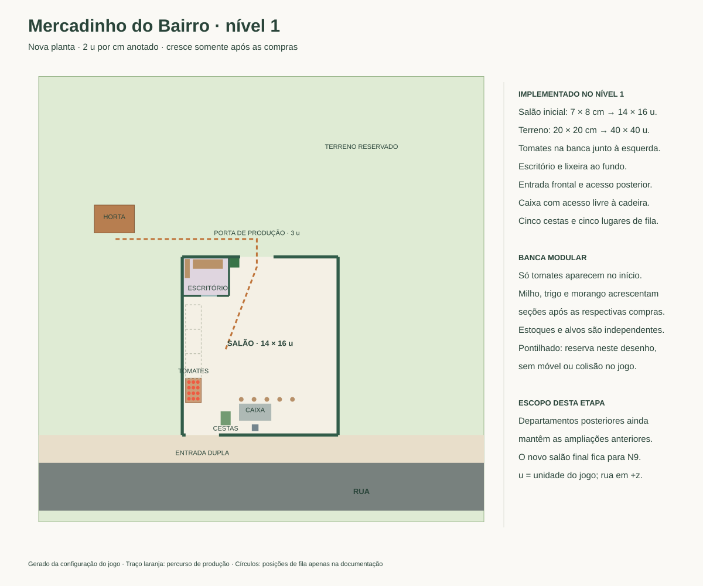

# Nova planta — nível 1

Registro da entrega N1. Para a etapa atual de milho, a reserva do trigo, os limites caminháveis e a migração V6, consulte [PLANTA-LOJA-N3.md](PLANTA-LOJA-N3.md).

Implementada em 14/10/2026, com a posição da horta corrigida após comparar diretamente o painel N1–2 do desenho original. A horta de tomates fica inteiramente atrás da parede do fundo, na faixa posterior esquerda. A referência visual enviada depois pelo jogador definiu um canteiro compacto de **3,6 × 2,5 u**, com as mesmas oito plantas, mais próximo do escritório. Esta entrega implementa o início da loja e a banca modular; os demais painéis ainda serão adaptados. As expansões laterais e o anexo dos níveis posteriores continuam funcionando na geometria anterior, conectados ao salão inicial novo.

## Decisões e coordenadas

Escala única de **2 unidades por cm anotado**, sem equivalência com metros. `x` cresce para a direita; `z`, em direção à rua. Frente e esquerda ficam ancoradas. O salão inicial tem **14 × 16 u**, correspondente à proporção anotada de 7 × 8. O terreno tem **40 × 40 u**. A região caminhável conserva os limites anteriores; a faixa posterior adicional é reserva visual.

| Elemento | Centro x / z | Largura × profundidade |
| --- | --- | --- |
| Terreno | 4 / -5,5 | 40 × 40 |
| Salão | 3,9 / -1,3 | 14 × 16 |
| Escritório | -1 / -7,55 | 4,2 × 3,5 |
| Porta de produção | 3,6 / -9,3 | vão de 3 |
| Entrada frontal | -1,3 / 6,7 | vão de 3 |
| Banca inicial de tomates | -2,1 / 2,7 | 1,4 × 2,2 |
| Horta de tomates | -9,2 / -12,7 | 3,6 × 2,5 |
| Coleta de tomates | -9,2 / -10,9 | face voltada para a loja |
| Balcão do caixa | 3,45 / 4,65 | 2,9 × 1,53 |
| Cadeira do caixa | 3,45 / 6,05 | acesso pelo corredor posterior |
| Suporte de cestas | 0,8 / 5,2 | 0,9 × 1,25 |

A porta lateral antiga foi fechada. A porta dupla posterior fica aberta para o exterior, com colisões correspondentes às folhas recolhidas. O caminho até os tomates permanece na faixa atrás da loja; o percurso antigo pela lateral foi removido. A posição posterior esquerda segue os elementos `61`, `60` e `21` do modelo draw.io incorporado ao SVG. As dimensões compactas e a proximidade do escritório seguem a imagem posterior enviada pelo jogador; a coleta foi ajustada à face voltada para a loja. O jogador pode percorrer o terreno e usar os acessos livres; o repositor usa a porta posterior em suas viagens de produção. O caixa foi afastado 0,6 u da fachada para permitir acesso real à cadeira. A fila inicial mantém cinco pontos, começando em `(2,2; 3,5)`, com intervalo de 1,15 u.

O escritório conserva sua função, computador, porta deslizante e móveis, deslocados 1 u para o fundo. O símbolo circular não recebeu uma nova mecânica. O suporte de cestas continua ocupando o lugar provisório previsto no plano.

## Banca de hortifruti

Modelo procedural inspirado na referência enviada: madeira clara, tábuas verticais, pés, bordas elevadas e bandeja escura levemente inclinada. A referência não é incorporada como imagem ao jogo.

No início existe **apenas a seção de tomates**, vazia até o jogador abastecer. As compras existentes acrescentam milho, trigo e morango em direção ao fundo, sem mover as seções anteriores. Cada seção mede 1,4 × 2,2 u; o móvel completo chega a 8,8 u de comprimento e termina antes do escritório. Nenhuma seção bloqueada é desenhada ou cria colisão. Compras fora de ordem deixam a seção ausente até sua própria compra.

As seções contíguas formam um único volume sólido. Cada produto mantém seu estoque, preço, capacidade e pontos de compra. A reposição ocorre na face do corredor, na faixa da seção visitada. Na divisória exata, a seção mais próxima da frente tem prioridade estável; esgotar esse produto no inventário não passa automaticamente a abastecer a vizinha. Paredes e outros móveis continuam impedindo interações através deles.

## Salvamento e compatibilidade

`versaoLayout` passa para **5**, preservando a chave e o formato do salvamento. A versão 4 foi a primeira implementação, com a horta lateral incorreta. Saves V3 e V4 recebem posições recuperáveis na migração, mantendo progresso, compras, estoques e cargas. Clientes preservados durante assaltos também são recuperados na geometria nova. O segundo carregamento não reaplica a migração.

Para manter os níveis posteriores utilizáveis nesta entrega, a primeira extensão lateral foi ajustada à nova borda direita e as paredes posteriores foram alinhadas à profundidade de 16 u. O ponto de coleta da geleia passou para a lateral acessível da oficina. O trigo foi afastado para `(-8,8; -17,6)`, com coleta em `(-8,8; -15,25)`, para manter a separação do canteiro de tomates mais largo. A ampliação somente no N9 e a remoção do anexo artesanal **ainda não foram implementadas**; pertencem às próximas etapas.

Regenerar esta planta com `node scripts/render-floor-plan.mjs`. Os SVGs V2 e as capturas anteriores ficam como referências históricas. Evidências atuais em [VERIFICACAO.md](VERIFICACAO.md).
