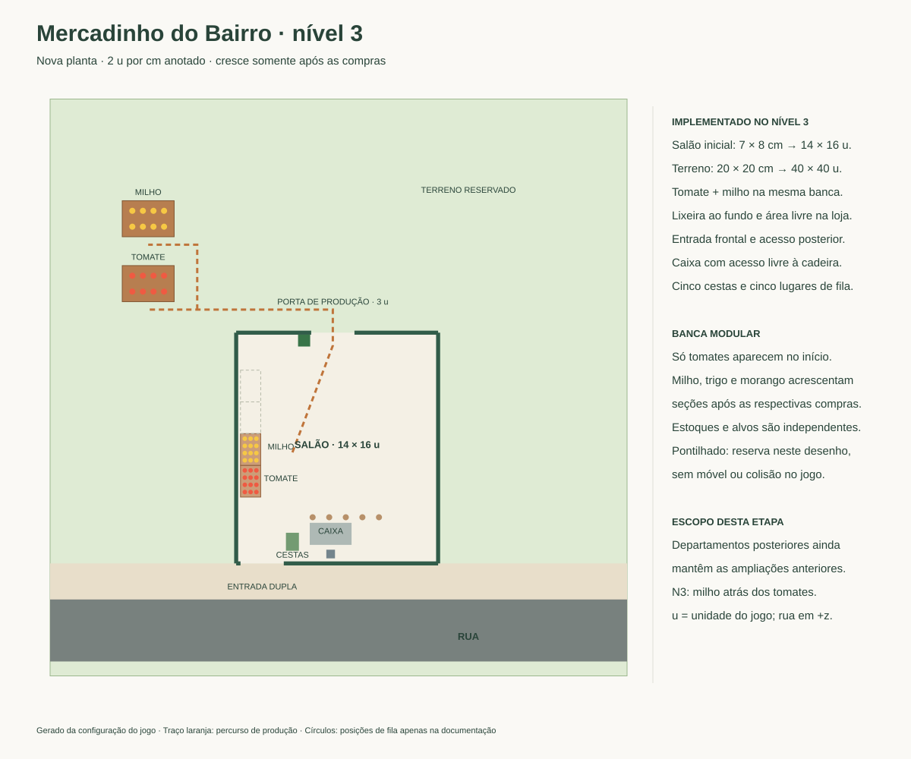
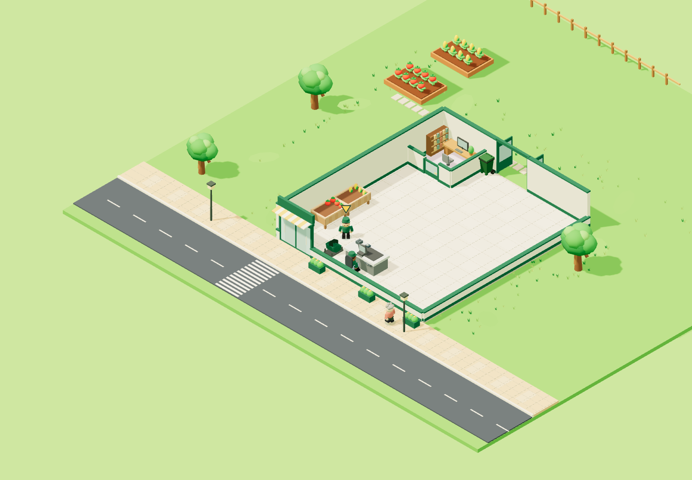

# Nova planta — nível 3: milho

Registro da entrega N3. Para ovos, remoção da extensão lateral N4 e migração V7, consulte [PLANTA-LOJA-N4.md](PLANTA-LOJA-N4.md).

Implementado em 14/10/2026, seguindo o painel N3 do [desenho original](mercadinhoDoBairro.drawio.svg). O milho ocupa um novo canteiro alinhado atrás do tomate, mais distante da parede. **As duas hortas ficam inteiramente atrás da loja.** A posição e as dimensões do tomate aprovadas pelo jogador foram preservadas.

## Compra e operação

Chegar ao nível 3 disponibiliza a compra **Uma nova colheita**, por **R$ 350**, no escritório. A compra revela o canteiro com oito espigas prontas e acrescenta a seção de milho à banca de madeira existente. O salão permanece com **14 × 16 u**. As demais fontes continuam bloqueadas até suas compras.

Saia pela porta dos fundos para colher milho e retorne à seção correspondente da banca, acessível pelo corredor. Tomate e milho conservam estoques separados; cada seção comporta 12 unidades. O milho cresce a cada 2,8 segundos, guarda até oito unidades na horta e custa R$ 10 por unidade ao cliente. A contratação do caixa no nível 2 continua sendo uma compra independente.

## Posições e compatibilidade

`x` cresce para a direita; `z`, em direção à rua. A parede posterior fica em `z = -9,3`.

| Elemento | Centro x / z | Largura × profundidade |
| --- | --- | --- |
| Tomate, preservado | -9,2 / -12,7 | 3,6 × 2,5 |
| Coleta de tomate | -9,2 / -10,9 | face voltada à loja |
| Milho | -9,2 / -17,2 | 3,6 × 2,5 |
| Coleta de milho | -9,2 / -15,4 | face voltada à loja |
| Seção de tomate | -2,1 / 2,7 | 1,4 × 2,2 |
| Seção de milho | -2,1 / 0,5 | 1,4 × 2,2 |

O painel N3 tem milho e tomate na mesma coluna, com milho acima do tomate: células `79` e `78`, comparadas ao salão `68` e grupo `67` do modelo draw.io incorporado. As dimensões compactas seguem a referência visual já aprovada para o tomate. Cada canteiro tem quatro plantas por fileira, em duas fileiras, com margem de 0,7 u às bordas. O espaço entre os dois canteiros é de 2 u, maior que o alcance combinado das interações, impedindo colher o produto vizinho.

A posição antiga do trigo coincidia com o novo milho. Sua reserva passa para `(-9,2; -21,7)`, com o mesmo canteiro compacto e coleta em `(-9,2; -19,9)`. Ele continua bloqueado até a compra no nível 7. O limite caminhável posterior passa para `z = -24,5`, dentro do terreno existente, permitindo circular ao redor dessa reserva. As demais etapas posteriores ainda conservam as ampliações anteriores; a adaptação completa da planta até N15 permanece pendente.

A versão espacial passa de **5 para 6**. A migração conserva compras, dinheiro, estoques, progresso e cargas; recupera jogador e repositor em posições acessíveis. Recarregar novamente não repete a migração. A chave e o formato do salvamento permanecem iguais.

## Evidências

As capturas usam uma partida isolada de nível 3, com caixa e milho comprados e quatro unidades de cada produto colhidas e repostas na banca. As hortas tiveram tempo para regenerar. Essa preparação não altera o salvamento do jogador.

[Verificações e resultados](VERIFICACAO.md). Regenerar as plantas N1 e N3 com `node scripts/render-floor-plan.mjs`.
