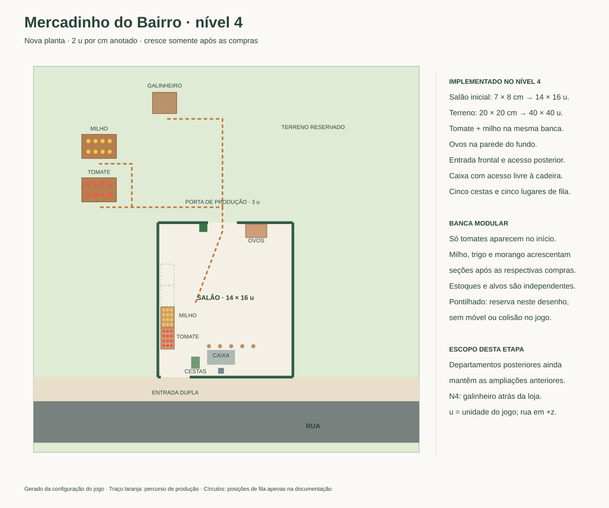
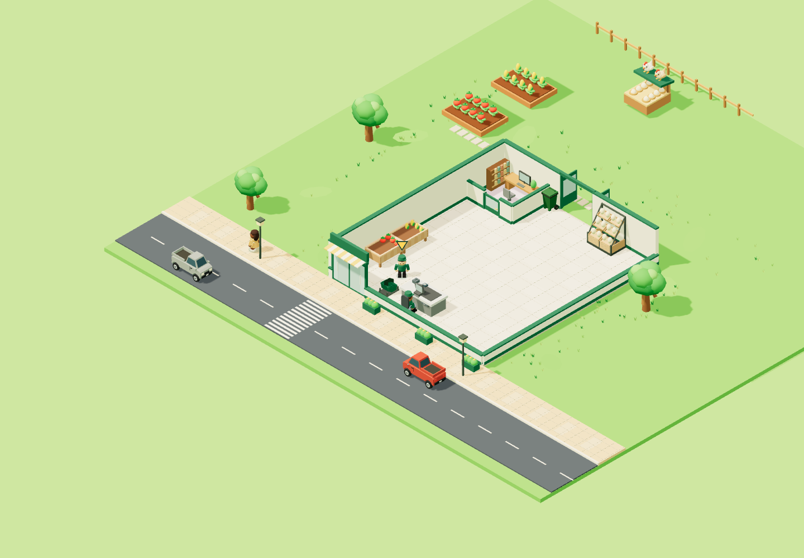
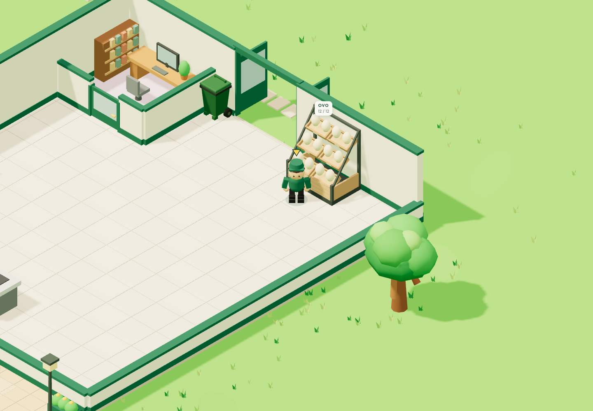

# Nova planta — nível 4: ovos

Implementado em 14/10/2026, seguindo o painel N4 do [desenho original](mercadinhoDoBairro.drawio.svg). O galinheiro fica inteiramente atrás da loja, mais ao fundo e à direita do milho. O expositor de ovos fica encostado à parede posterior, à direita da porta de produção. A referência visual mais recente do jogador definiu caixotes abertos inclinados em três degraus, base de madeira e estrutura metálica escura. Cada nível recua e sobe para deixar os ovos visíveis da câmera isométrica. **Comprar ovos mantém o salão de 14 × 16 u**, sua parede lateral, fachada e piso.

## Compra e operação

No nível 4, compre **Ala dos ovos** por **R$ 500** no escritório. O nome e o identificador salvo `alaProducao` foram preservados. A compra instala o galinheiro e a banca; não exige comprar milho. O galinheiro começa sem ovos e produz uma unidade a cada **3,5 segundos**, sem insumos, até guardar oito. A banca comporta 12 ovos; cada unidade é vendida por **R$ 15**. A demanda gradual existente continua funcionando após a produção inicial.

Saia pela porta dos fundos para coletar ovos. Retorne à banca da parede posterior e abasteça pelo corredor do salão. O repositor também usa a porta posterior quando contratado nos níveis seguintes. A animação de instalação dos equipamentos mantém a duração de quatro segundos; carregar uma compra existente mostra os equipamentos prontos.

## Posições e compatibilidade

`x` cresce para a direita; `z`, em direção à rua. A parede posterior fica em `z = -9,3`.

| Elemento | Centro x / z | Largura × profundidade |
| --- | --- | --- |
| Galinheiro | -2,4 / -21,7 | 2,5 × 2,2 |
| Coleta de ovos | -2,4 / -20,05 | face voltada à loja |
| Estante de ovos | 7,1 / -8,45 | 2,2 × 1,4 |
| Reposição e compra | 7,1 / -7,15 | face voltada ao salão |

A leitura usa as células `249` (galinheiro), `248` (milho), `99` (ovos), `94` (porta), `86` (salão) e `85` (grupo) do modelo draw.io incorporado. O desenho conserva o salão inicial de 8 × 7 cm no N4. Os tomates e o milho mantêm as posições e dimensões aprovadas na etapa anterior.

A versão espacial passa de **6 para 7**, mantendo a chave e o formato do salvamento. A migração preserva compras, dinheiro, ovos produzidos, estoques, progresso parcial e cargas do jogador e do repositor. As posições são recuperadas; o segundo carregamento não repete a migração.

As etapas N5+ ainda mantêm expansões anteriores. A antiga faixa lateral de 1,2 u deixa de aparecer no N4 e acompanha somente a expansão legada do leite, até sua adaptação. Para evitar conflito entre o novo expositor de ovos e a futura entrega de trigo, a caixa de entrada da padaria passa para `(5,75; -5)`, com acesso em `(4,7; -5)`; moinho, forno e vitrine conservam as posições anteriores. A adaptação completa da padaria permanece pendente.

O expositor interno pode ficar próximo à futura oficina externa de geleias porque a parede posterior separa seus alcances. A verificação exige que a parede cubra toda a projeção compartilhada das áreas de interação; um vão ou uma parede curta não recebe essa exceção. Interações através da parede continuam bloqueadas.

## Evidências

As capturas atualizadas usam uma partida isolada de nível 4, com caixa, milho e ovos comprados e estoque preparado: quatro tomates, quatro milhos e 12 ovos para mostrar os três níveis da estante. Nenhum salvamento pessoal foi usado. A coleta, reposição e venda reais continuam cobertas pelo teste N4.

A estante mantém a área de interação de 2,2 × 1,4 u e comporta quatro ovos por nível, divididos entre dois caixotes. As animações de reposição usam a altura e o recuo do nível correspondente, e a etiqueta fica acima do móvel. Um teste de raios verifica que a estrutura não bloqueia o centro de nenhum dos 12 ovos na direção da câmera do jogo. A alteração é visual; não exige nova migração espacial.

[Resultados das verificações](VERIFICACAO.md). Regenerar as plantas N1, N3 e N4 com `node scripts/render-floor-plan.mjs`.
