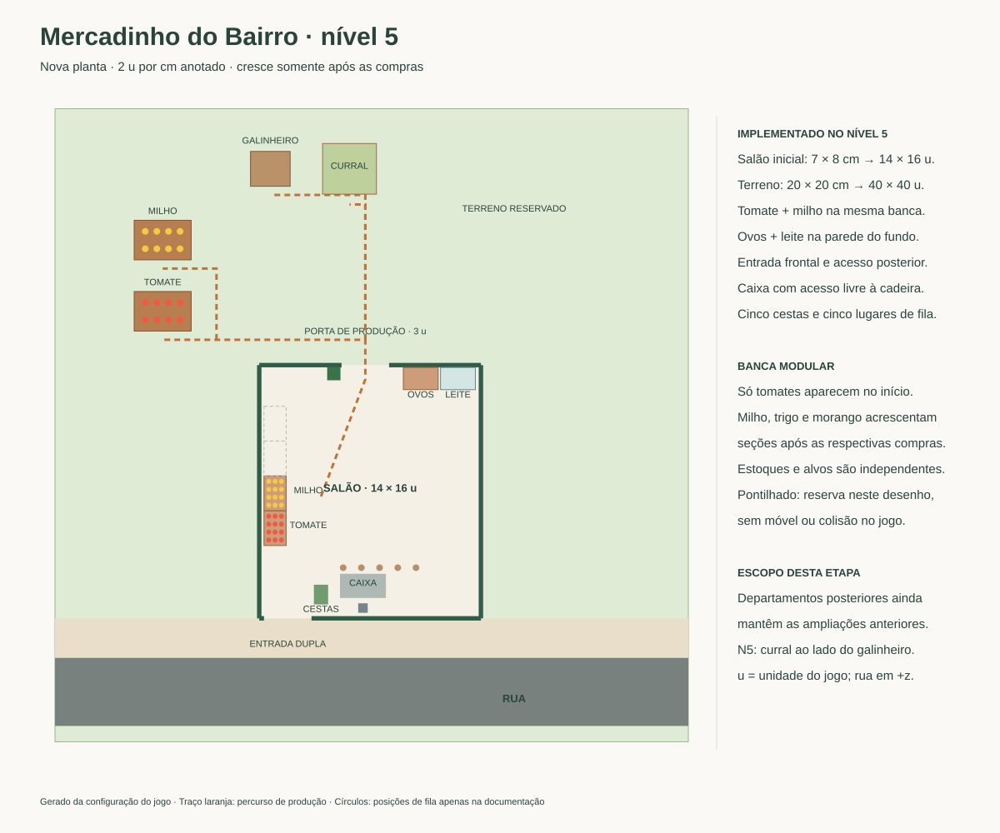
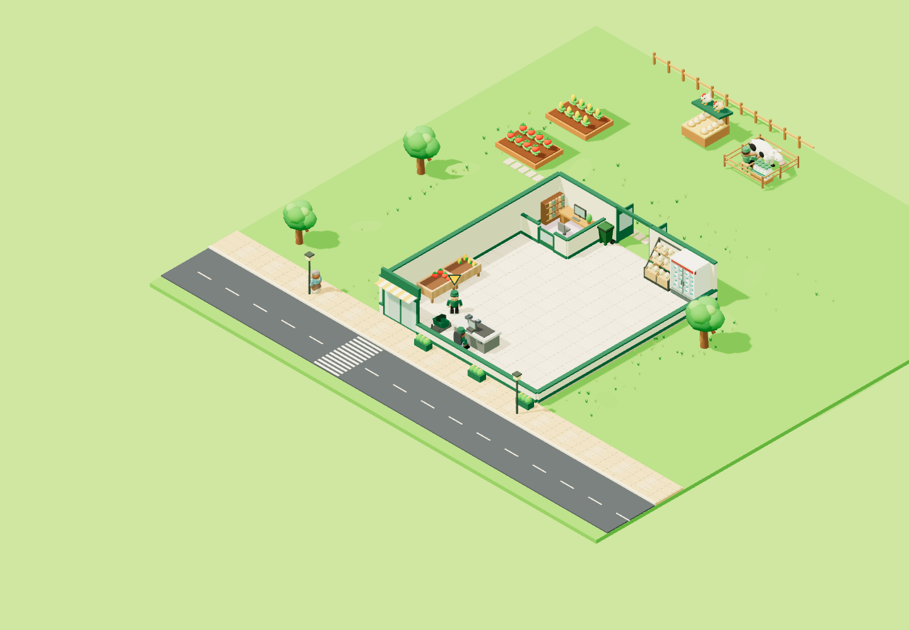
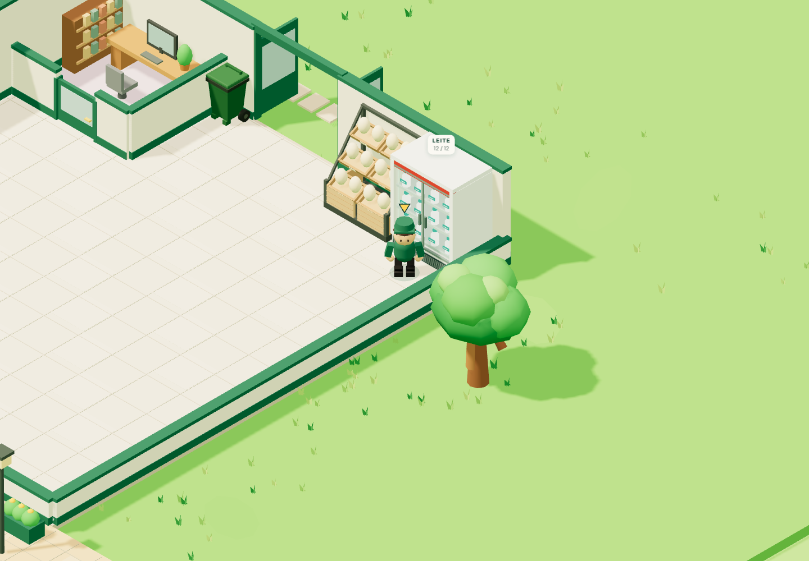

# Nova planta — nível 5: leite

Implementado em 14/10/2026, seguindo o painel N5–6 do [desenho original](mercadinhoDoBairro.drawio.svg). O curral fica inteiramente atrás da loja, à direita do galinheiro, na mesma faixa posterior. O refrigerador fica na parede do fundo, à direita da estante de ovos. **O salão mantém 14 × 16 u**, piso, fachada, parede lateral e acesso posterior.

## Compra e operação

No nível 5, compre **Ala do leite** por **R$ 800** no escritório. A compra conserva o identificador salvo `alaLeite` e instala o curral com vaca e o refrigerador; não exige milho ou ovos. O curral começa vazio e produz uma garrafa a cada **4,5 segundos**, sem insumos, até guardar oito. O refrigerador comporta 12 garrafas. Cada unidade é vendida por **R$ 20**; a demanda gradual existente foi preservada.

Use a porta dos fundos para coletar leite. Retorne à frente do refrigerador e abasteça pelo corredor. Ovos e leite têm faixas de reposição próprias: inventário misto abastece somente o expositor visitado. Na divisória, ovos têm prioridade estável; esgotar esse item não alterna automaticamente para leite. A contratação do repositor continua disponível no nível 6.

## Posições e compatibilidade

`x` cresce para a direita; `z`, em direção à rua. A parede posterior fica em `z = -9,3`.

| Elemento | Centro x / z | Largura × profundidade |
| --- | --- | --- |
| Curral | 2,6 / -21,7 | 3,4 × 3,2 |
| Coleta de leite | 2,6 / -19,45 | face voltada à loja |
| Refrigerador | 9,45 / -8,45 | 2,2 × 1,4 |
| Reposição e compra | 9,45 / -7,15 | face voltada ao salão |

A leitura usa as células `246` (curral), `245` (galinheiro), `121` (leite), `120` (ovos), `106` (salão) e `105` (grupo) do modelo draw.io incorporado. O desenho mantém o salão de 8 × 7 cm. Tomates, milho e a estante de ovos em caixotes inclinados conservam as posições aprovadas.

O curral foi dimensionado para manter os corredores livres entre as fontes existentes. Vaca, cocho e garrafas foram ajustados ao seu interior. Pela referência posterior do jogador, o leite usa um refrigerador vertical branco junto à parede, com duas portas de vidro, puxadores, cabeçalho vermelho e grade inferior de ventilação. As 12 garrafas ficam em quatro colunas sobre três prateleiras internas; posições de reposição e etiqueta acompanham a altura do móvel. A área de interação permanece em 2,2 × 1,4 u, sem nova migração espacial. Testes verificam apoio nas prateleiras e visibilidade das garrafas através do vidro na direção da câmera.

A versão espacial passa de **7 para 8**, mantendo a chave e o formato do salvamento. Compras, dinheiro, estoque, cargas e progresso parcial de produção são preservados. Jogador e repositor recebem posições acessíveis, sem nova cobrança; o segundo carregamento não repete a migração.

Para manter os níveis posteriores utilizáveis, a reserva legada de morangos passou para `(-2,4; -16,4)`, com coleta em `(-2,4; -14)`, liberando o corredor do novo curral. Continua bloqueada até N11 e aguardando a adaptação completa dessa etapa. As faixas laterais legadas agora aparecem somente a partir do trigo no N7; a ampliação principal apenas no N9 e a remoção do anexo antigo ainda estão pendentes.

## Evidências

As capturas usam uma partida isolada N5 com caixa, milho, ovos e leite comprados. Estoques preparados para inspeção: quatro tomates, quatro milhos, 12 ovos e 12 garrafas; fontes com oito unidades. Nenhum salvamento pessoal foi usado. O teste N5 percorre produção, coleta, reposição, venda por R$ 20 e devolução de cesta com as regras reais.

[Resultados das verificações](VERIFICACAO.md). Regenerar N1, N3, N4 e N5 com `node scripts/render-floor-plan.mjs`.
